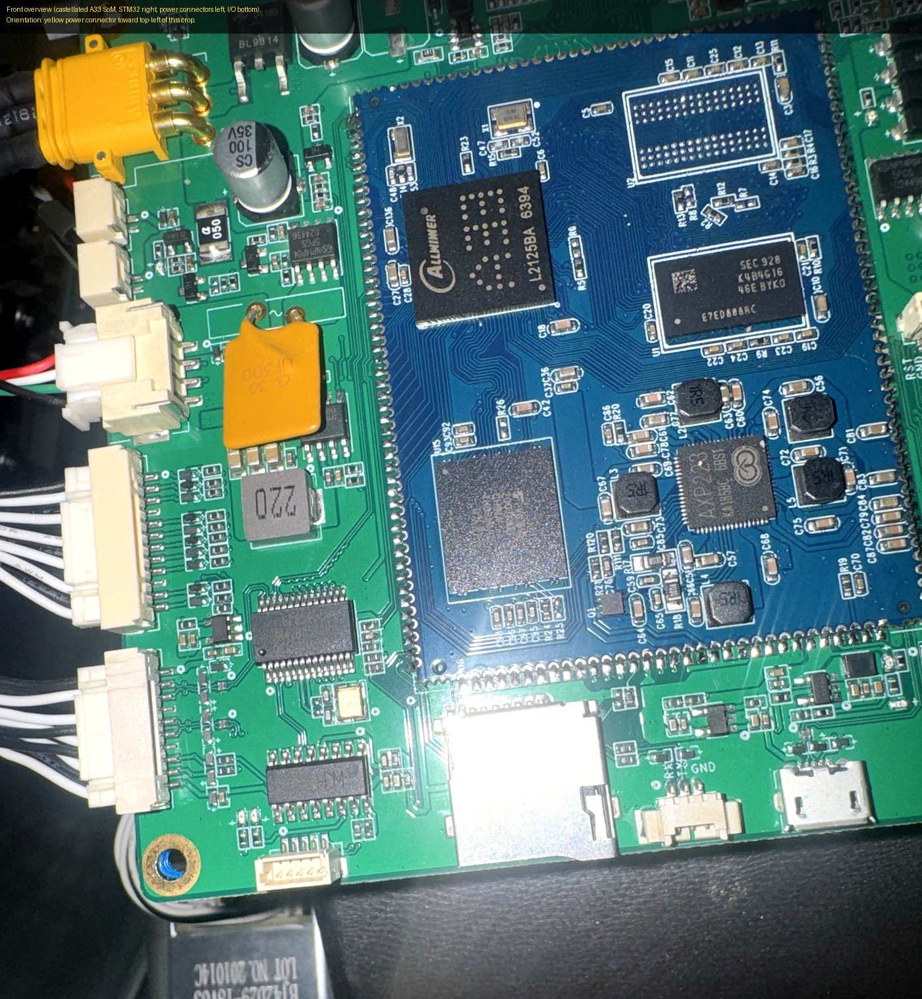
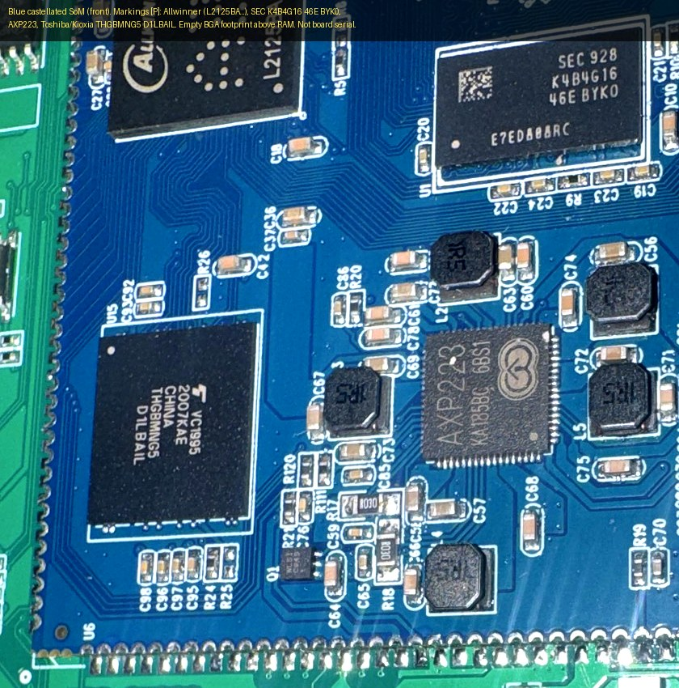
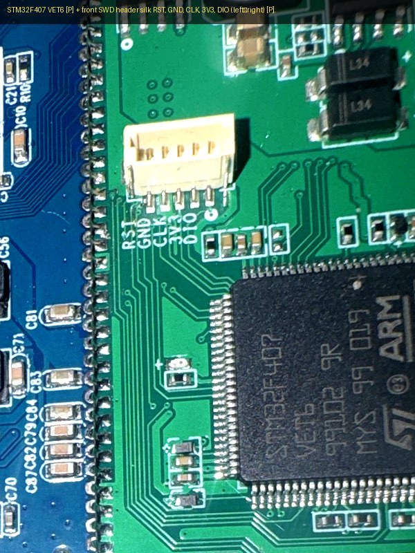
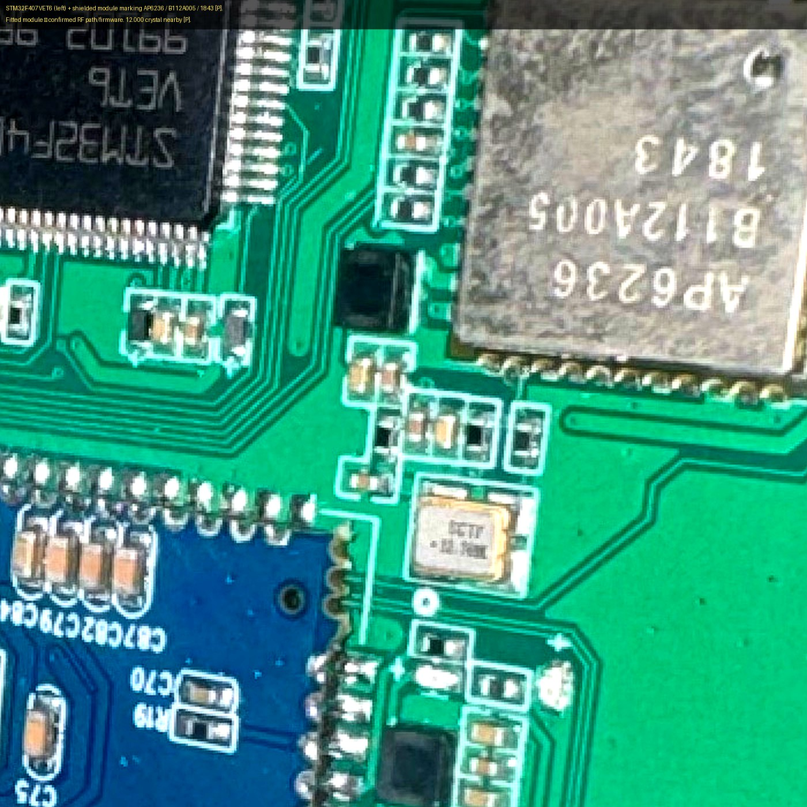
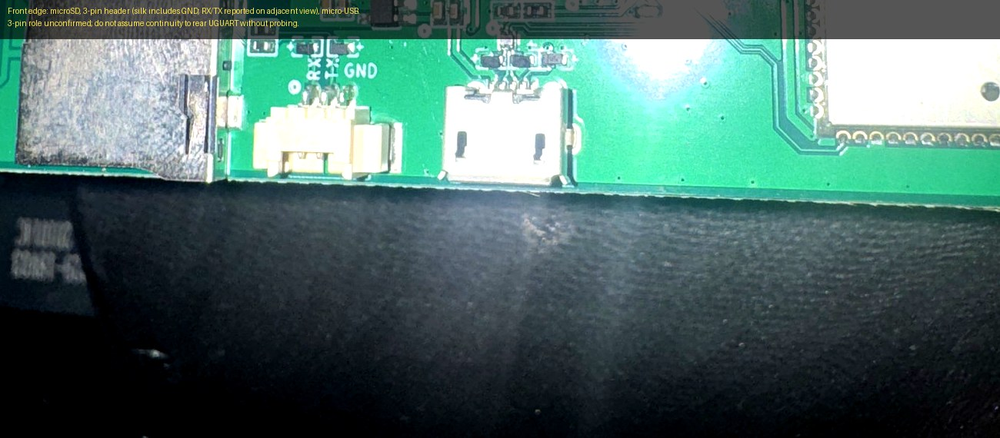
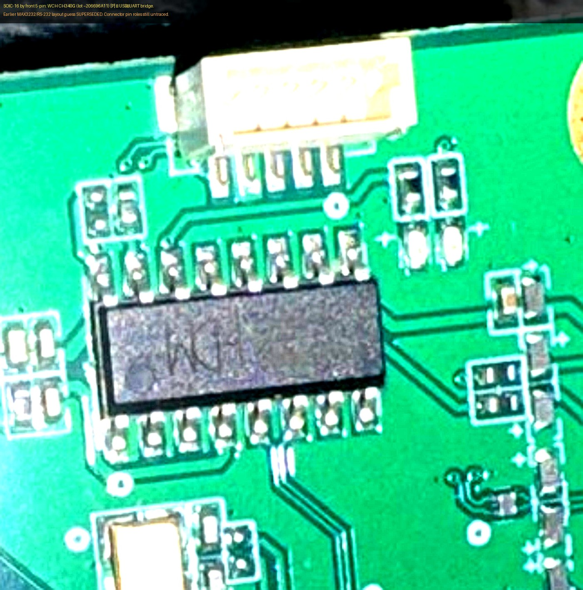
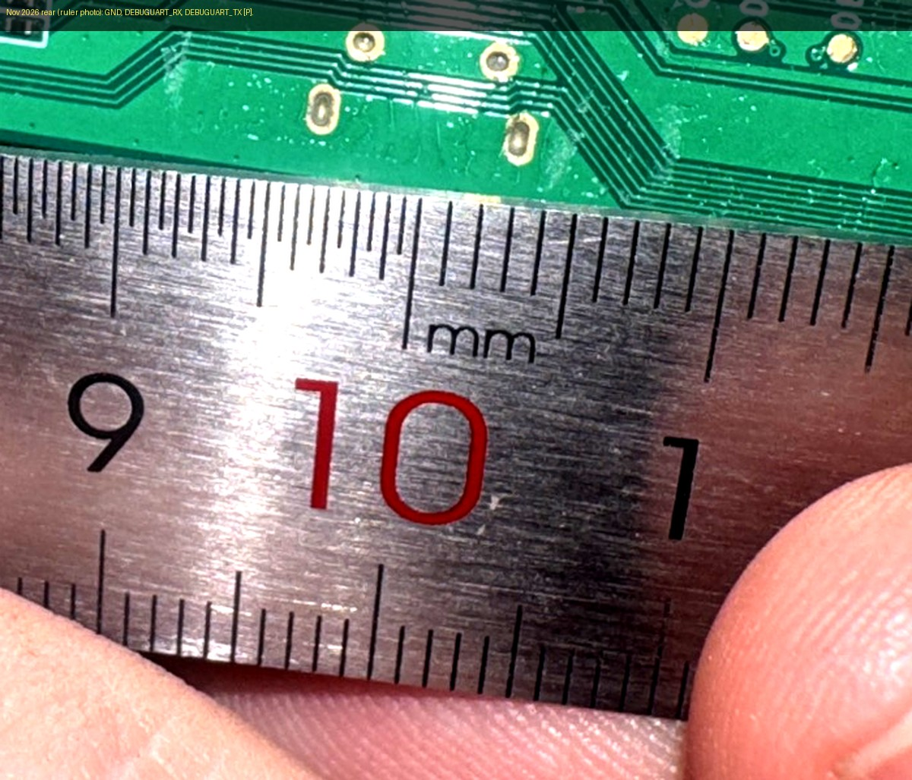
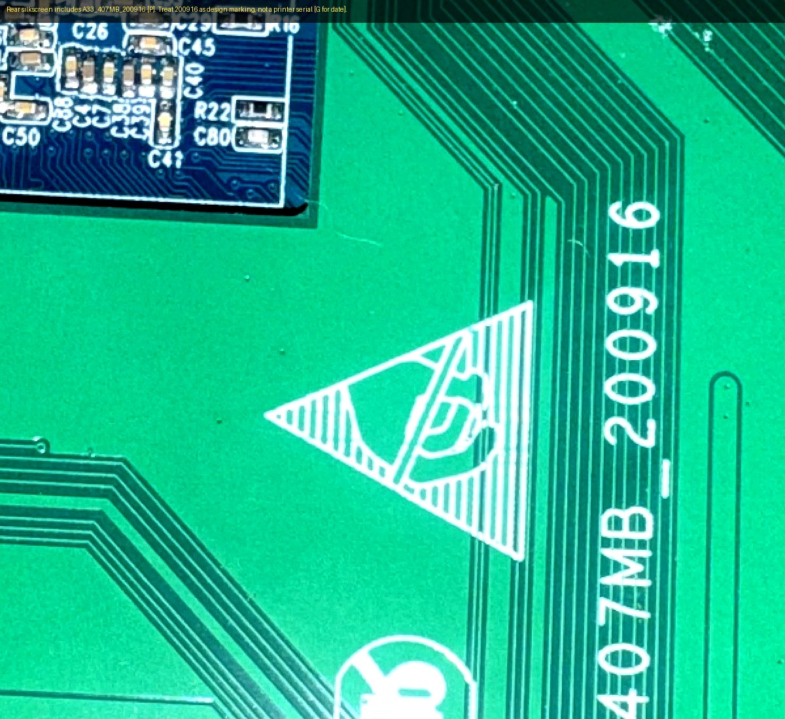
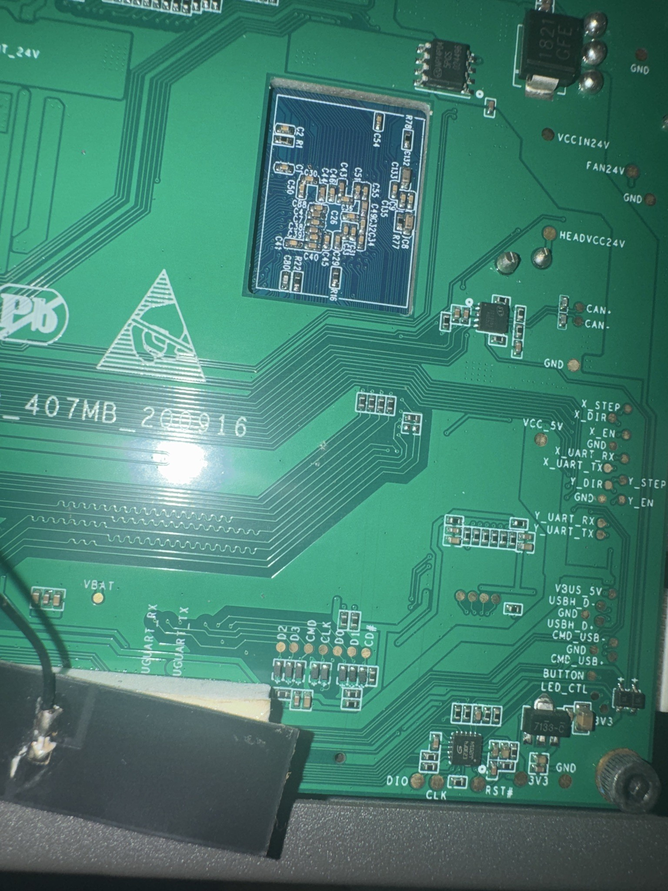

# IVI main board: `A33_407MB_200916`

Photos: owner set from **2026-10-31** (EXIF/GPS stripped; `images/board/mainboard_*.jpg`) plus a second set from **2026-11-05** with the board **exposed for inspection** in the chassis (standoffs visible; removal not claimed) (`images/board/front_*.jpg`, `rear_board_marking.jpg`). See `images/board/SOURCES_2026-11.md`.

Evidence labels used throughout:

| Tag | Meaning |
|---|---|
| **[P]** | Read from owner board photos (silkscreen or chip top marking) |
| **[F]** | Matches firmware / decompile findings (`firmware_report.md`, `supx_decompile_report.md`) |
| **[D]** | Supported by a manufacturer / primary datasheet citation |
| **[G]** | Inference or guess — not proven on this unit |
| **[U]** | Unknown / not readable / not measured |

**Orientation convention for this page**

- **Front** = component side with the blue castellated SoM, STM32 LQFP, microSD, micro-USB, and white headers facing you.
- **Rear** = solder / test-pad side with the large `A33_407MB_200916` silkscreen and most gold test pads.
- Front left/right are **not** the same as rear left/right: the board flips. When comparing views, use silkscreen names (`STM32`, `microSD`, `BEDVCC24V`, etc.), not “left edge.”
- Chip **date / lot codes** (for example STM32 `MYS 99 019`, Samsung `928`, Toshiba `2007KAE`) are **not** the printer serial. The printer serial must never be committed to this repo.

| Front overview (2026-11) | SoM chip markings |
|---|---|
|  |  |

| STM32 + SWD header | AP6236 + STM32 |
|---|---|
|  |  |

| Front SD / 3-pin / USB | Bottom-left 5-pin + CH340G |
|---|---|
|  |  |

| Rear DEBUGUART pads (2026-11 ruler) | Rear board marking |
|---|---|
|  |  |

| Center/right (2026-10) | Left edge connectors (2026-10) |
|---|---|
|  |  |

| Left edge close-up | Right edge | Debug / SD area |
|---|---|---|
|  |  |  |

---

## 1. Board marking

- Silkscreen **`A33_407MB_200916`** **[P]** on the rear.
- Reading of the name **[G]**: combined main board intended for an **Allwinner A33** application processor plus an **STM32F407** motion MCU (`407` + `MB`).
- Suffix **`200916`**: often a design/fab date (2020-09-16) in Chinese vendor silk, but **that interpretation is not sourced** — treat it as a design marking only **[G]**. It is **not** a unit serial.

---

## 2. Evidence table (2026-11 photo pass)

| Item | Status | Notes |
|---|---|---|
| Board silk `A33_407MB_200916` | **Confirmed visible [P]** | Rear silk |
| STM32 top mark `STM32F407` / `VET6` | **Confirmed visible [P]** | LQFP; lot lines `991D2 9R`, `MYS 99 019` |
| STM32 flash / SRAM / package | **Datasheet-supported [D]** | VE = 512 KB flash; 192+4 KB SRAM; LQFP100 — [ST DS8626](https://www.st.com/resource/en/datasheet/stm32f407ve.pdf) |
| Blue castellated SoM | **Confirmed visible [P]** | Soldered to carrier; not a socket |
| Allwinner logo + lot `L2125BA…` on SoM | **Confirmed visible [P]** | Exact “A33” die marking not always readable on every photo; board name + AXP223 companion strongly support A33 **[G/D]** |
| SoM = Allwinner A33 (quad Cortex-A7) | **Inferred [G] + ecosystem [D]** | Board name; AXP223 is the usual A33 PMIC ([linux-sunxi AXP223](https://linux-sunxi.org/AXP223), [AXP223 datasheet](https://dl.linux-sunxi.org/AXP/AXP223-en.pdf)); Linux/Qt UI ELF **[F]** |
| Samsung RAM top mark | **Confirmed visible [P]** | `SEC 928` / `K4B4G16` / `46E BYKO` (final glyph **O vs 0 ambiguous** on photo) + lot line |
| DRAM capacity / type | **Contingent [G→D]** | If the orderable is Samsung **K4B4G1646E-BYK0**, datasheets describe **4 Gb (512 MB) ×16 DDR3L**. That capacity is **not independently verified** here without an accessed primary Samsung PDF for the exact orderable; treat as contingent on the marking decode. Mirror PDF example: [K4B4G1646E datasheet (mirror)](https://file.icallin.com/resources/data-sheet/DS_K4B4G1646E_BY_M_Rev1_11-0.pdf). Related Samsung product pages exist for other `K4B4G1646E-*` suffixes ([example](https://semiconductor.samsung.com/us/dram/ddr/ddr3/k4b4g1646e-bcnb/)). |
| Toshiba/Kioxia `THGBMNG5` / `D1LBAIL` | **Confirmed visible [P]** | Full orderable string **THGBMNG5D1LBAIL** |
| eMMC capacity | **Datasheet-supported [D]** | **4 GB** eMMC 5.0 — [Kioxia consumer eMMC table](https://www.mouser.com/specsheets/KIOXIA_Consumer_Grade_e_MMC.pdf) |
| X-Powers **AXP223** | **Confirmed visible [P]** | Batch lines like `KA185BC 6BS1` |
| AXP223 role | **Datasheet-supported [D]** | Multi-rail PMIC used with A23/A33 |
| Empty BGA footprint on SoM (above RAM) | **Confirmed visible [P]** | Unpopulated option / second memory site **[U]** |
| Shielded module `AP6236` / `B112A005` / `1843` | **Confirmed visible [P]** | Next to STM32 |
| AP6236 function | **Datasheet-supported [D]** | Ampak 802.11b/g/n + Bluetooth SIP; Wi-Fi SDIO, BT UART — [AP6236 spec](https://www.boardcon.com/download/AP6236_WIFI_Module.pdf). **Fitted ≠ antenna wired or firmware enabled [U]** |
| 12.000 MHz crystal near RF module | **Confirmed visible [P]** | |
| Front SWD header silk `RST`, `GND`, `CLK`, `3V3`, `DIO` | **Confirmed visible [P]** | Order left→right on front header by STM32 |
| Rear / pad SWD clusters `RST#`, `DIO`, `CLK`, `3V3`, `GND` | **Confirmed visible [P]** | At least one near STM32; a second set exists near bottom-right QFN area (see older table) |
| Rear debug UART pads | **Confirmed visible [P] (2026-11 primary)** | Nov 2026 ruler photo silk reads **`GND`**, **`DEBUGUART_RX`**, **`DEBUGUART_TX`**. An older 2026-10 crop was previously transcribed as `UGUART_*`; that older reading is **not re-proven** against the current photos and must not override them. |
| Front 3-pin by micro-USB (`GND` / `TX` / `RX` reported) | **Partially confirmed [P]** | Candidate breakout; **continuity to rear debug UART pads not proven** |
| Front bottom-left **5-pin** + **SOIC-16** | **Confirmed visible [P]** | Distinct from STM32 SWD and from the 3-pin by USB |
| SOIC-16 = **WCH CH340G** | **Confirmed visible [P]** | Rotated macro: WCH logo + `CH340G` + lot ~`206696A11`. Official USB↔UART bridge ([WCH CH340 datasheet](https://www.wch-ic.com/downloads/CH340DS1_PDF.html)). |
| Earlier RS-232 / MAX3232 guess | **Superseded** | Polarized caps near a SOIC-16 looked like a charge-pump footprint; **new marking proves CH340G instead**. Do not treat the 5-pin as RS-232 on that basis. |
| 5-pin connector net (USB D± vs UART vs power) | **Unknown [U]** | CH340G has USB (`UD+`/`UD-`) and UART (`TXD`/`RXD`) pins — **which nets reach the 5-pin is untraced**. Still measure voltages before attaching anything. |
| Axis `X_UART_*` / `Y_UART_*` (and Z/F on other edges) | **Confirmed visible [P]** | Do **not** assume driver IC type from pads alone |
| CTP I²C + LCD bias rails | **Confirmed visible [P]** | See connector table |
| microSD slot + micro-USB | **Confirmed visible [P]** | Host vs device role of micro-USB **[U]** |
| Yellow high-current power connector | **Confirmed visible [P]** | Family/pitch not measured (XT30/XT60-class appearance only) **[U]** |
| Thermistor short as root cause of cold head reading ~248/250 °C | **User report only** | See §8 — do not treat as proven hardware failure from photos |

---

## 3. Dual-processor architecture (hypothesis vs evidence)

**What is solid**

- One **combined carrier** mounts both a Linux-capable SoM and an STM32F407 **[P]**.
- Firmware split **[F]**:
  - Qt ARM Linux UI ELF (`firmware.bin`) + separate HTTP `:8080` process on the application side (`firmware_report.md`, `network.md`).
  - Marlin-derived motion image in `firmware.supx` targeting STM32 (`supx_report.md`, `supx_decompile_report.md`).
  - UI talks to motion over an internal serial path (`/dev/ttyUSB0`, 115200 8N1, line G-code) **[F]**.
  - External USB-C enumerates as CDC serial **straight to Marlin**, bypassing the Linux UI for G-code **[F]** (`network.md`).

**What is still a hypothesis [G]**

- Exact on-board wiring between A33 UART and STM32 USART (which pins, level shifting, who is DCE).
- Whether the front 3-pin, rear `DEBUGUART_*`, and/or the bottom-left 5-pin / CH340G share nets.
- Which CPU owns the AP6236 SDIO/UART lines (almost certainly the A33 on typical A33 tablets, but not traced here).

**Safe exploration (read-only first)**

| Path | Likely grants | Risk notes |
|---|---|---|
| STM32 **SWD** (`RST`/`GND`/`CLK`/`3V3`/`DIO`) | Inspect connection / RDP **status** with ST-Link | **Never** unlock or disable readout protection (can mass-erase). Do **not** claim a full flash dump is possible until RDP level is known. Never force 5 V onto `3V3`. |
| Rear **`DEBUGUART_RX`/`DEBUGUART_TX`** (Nov 2026 silk) | Candidate **debug / Linux console** | Measure idle/active levels first. Do **not** assume 3.3 V TTL. |
| Front **3-pin** by USB | Possible convenient breakout | Confirm continuity + voltage before use |
| Front **5-pin** by **CH340G** | Unknown — may be USB or UART side of the bridge **[U]** | Trace to CH340G pins before use. CH340G ≠ automatic “TTL-safe header.” Measure first. |
| USB-C CDC | Marlin G-code | Already used by the bridge; not a Linux shell |

---

## 4. Major ICs (readable markings)

### 4.1 STM32F407VET6 (motion MCU) — carrier board

| Field | Value | Tag |
|---|---|---|
| Top marking | `STM32F407` / `VET6` | **[P]** |
| Package | LQFP100 (100-pin) | **[P]/[D]** |
| Flash | **512 KB** (VE density) | **[D]** |
| SRAM | **192 KB** + **4 KB** backup | **[D]** |
| Core | Cortex-M4F up to 168 MHz | **[D]** |
| Citation | [ST STM32F407VE datasheet (DS8626)](https://www.st.com/resource/en/datasheet/stm32f407ve.pdf) | |

Front SWD header silk (by the chip), left → right: **`RST`, `GND`, `CLK`, `3V3`, `DIO`** **[P]** — classic SWDIO/SWCLK + reset/power.

### 4.2 Blue castellated SoM (application processor)

| Chip | Readable marking **[P]** | Identity | Citation |
|---|---|---|---|
| SoC | Allwinner logo; lot `L2125BA…` | **Likely A33** (board name + PMIC match); die text “A33” not always sharp | Allwinner A33 product brief; board silk |
| DRAM | `SEC … K4B4G16 46E BYK0` (+ lot line) | Samsung **K4B4G1646E-BYK0**, 4 Gb / **512 MB** ×16 DDR3L | Samsung K4B4G1646E-BYK0 datasheet family |
| eMMC | `THGBMNG5` / `D1LBAIL` (+ `VC1995` / `2007KAE` / `CHINA`) | **THGBMNG5D1LBAIL**, **4 GB** eMMC 5.0 | [Kioxia eMMC table](https://www.mouser.com/specsheets/KIOXIA_Consumer_Grade_e_MMC.pdf) |
| PMIC | **`AXP223`** (+ `KA185BC…`) | X-Powers AXP223 | [AXP223](https://dl.linux-sunxi.org/AXP/AXP223-en.pdf), [linux-sunxi](https://linux-sunxi.org/AXP223) |

Also visible on the SoM **[P]**: several power inductors (markings such as `1R5`, `5R6`, `4R7`), dense decoupling, and an **unpopulated** rectangular BGA footprint above the DRAM.

### 4.3 Ampak AP6236 (Wi-Fi / Bluetooth module)

Shield top mark **`AP6236` / `B112A005` / `1843`** **[P]**. Ampak AP6236 is a 2.4 GHz 802.11b/g/n + Bluetooth module (Wi-Fi over SDIO, BT over UART) — [AP6236 specification PDF](https://www.boardcon.com/download/AP6236_WIFI_Module.pdf) **[D]**.

Caveats: a soldered module does not prove the antenna path is intact, that Linux has drivers/firmware loaded, or that BT is used.

### 4.4 Other carrier parts (partial)

| Part | Observation | Tag |
|---|---|---|
| SOIC-16 by bottom-left 5-pin | Faint top mark (possible `ADM…` / `…HM`); surrounded by multiple polarized (`+`) caps | **[P]** layout; marking **[U]** |
| SOIC-8 near STM32 SWD pads | Present; marking poorly readable | **[P]**; role EEPROM/flash **[G]** (decompile shows bit-banged I²C EEPROM **[F]**) |
| SOT-89 `7133` near second SWD | 3.3 V LDO class | **[P]**; exact vendor **[G]** |
| Large inductors | e.g. rear `1821 GFE`; front `220`, `4R7` | **[P]** values only where legible |
| Electrolytics | e.g. `100` / `35V` near power input | **[P]** |
| Yellow radial near power (`CC 30` / `UF300` style marking reported) | Possible **30 V PPTC** resettable fuse class (Raychem/PolySwitch-style **UF300** marking appears on [RUEF300 SCD](https://akizukidenshi.com/goodsaffix/ruef300.pdf)) | Marking **[P]** if confirmed on unit; identity **[G]** until read clearly |
| Larger SSOP above CH340G area | Partial marks reported on a later macro | Exact part **[U]** - do **not** assume USB hub without a clear top mark |

---

## 5. Connector and pad inventory

### 5.1 Front user / debug I/O

| Item | Location | Silk / notes | Status |
|---|---|---|---|
| microSD push-push cage | Front edge | Boot / storage candidate for A33; also rear SDMMC test pads | **[P]**; which device is primary boot **[U]** |
| 3-pin white header | Between microSD and micro-USB | Reports include `GND`, `TX`, `RX` | **[P]** partial; function **[U]** until traced |
| micro-USB | Front edge | Data vs charge / host vs device **[U]** (rear also has `USBH_D±` silk for a **host** path) |
| 5-pin white header | Front **bottom-left**, near mounting hole | Traces into adjacent **CH340G** | **[P]**; net roles **[U]** until traced/measured |
| SWD 5-pin header | Beside STM32 | `RST GND CLK 3V3 DIO` | **[P]** |
| LCD FFC / CTP FFC | Edge ZIF | Matches rear CTP/LCD rail pads | **[P]** |
| Motor / sensor white JST-style | Multiple along edges | Bundles present | Mating family/pitch **[U]** until measured |
| Yellow high-current inlet | Near electrolytics | Appearance only | Exact connector series **[U]** |

### 5.2 Rear test pads (from 2026-10 set; still valid)

| Silkscreen | Location | Meaning / status |
|---|---|---|
| `RST#`, `DIO`, `CLK`, `3V3`, `GND` | Near STM32 / logo area | STM32 SWD **[P]** |
| `MTX_24V`, `MTY_24V`, `MTZ_24V`, `MTF_24V` | Left edge, red bundle | 24 V feed per motor driver board; **F = filament feeder (extruder)** **[P]** (F meaning **[G]**, strongly implied) |
| `VBAT-`, `VBATIN` / `VBAT` | Upper left / lower center | Battery-backup (power-loss) input **[P]** |
| `F_UART_TX/RX`, `F_EN`, `F_DIR`, `F_STEP` | Left edge | Extruder driver: UART + STEP/DIR/EN **[P][F]** |
| `Z_UART_TX/RX`, `Z_EN`, `Z_DIR`, `Z_STEP` | Left edge | Z tower driver **[P][F]** |
| `CHB`, `CHA` | Left edge | Unknown; CAN-H/L or encoder channels **[G]** |
| `3V3`, `DOOR_STAUS` (sic) | Left edge | Door switch **[P][F]** |
| `AGND`, `BEDTEMP` | Left edge | Bed thermistor input **[P]** |
| `INP`, `INN`, `AGNDO`, `AVDD_3V3` | Left edge | Differential analog input **[P]**; possibly load cell **[G]** |
| `LIMITSW_X/Y/Z` and `LIMIT_X/Y/Z` | Lower left | Two pads per axis **[P]**; three tower MAX endstops **[F]**. Why two labels per axis **[U]** |
| `MT_24V`, `MT_12V7` | Center | Motor 24 V and 12.7 V rails **[P]** |
| `VCCIN24V`, `FAN24V`, `GND` | Right edge, top | Main 24 V input and fan rail **[P]** |
| `BEDVCC24V` | Right edge, top | Heated bed 24 V **[P]** |
| `CAN+`, `CAN-`, `HEADVCC24V` | Right edge, 3-wire | Toolhead CAN + head 24 V **[P][F]** (CAN2, head ID 0x12) |
| `X_STEP/DIR/EN`, `X_UART_RX/TX` | Right edge | X tower driver **[P][F]** |
| `Y_STEP/DIR/EN`, `Y_UART_RX/TX` | Right edge | Y tower driver **[P][F]** |
| `VCC_5V` | Right side | 5 V rail **[P]** |
| `VBUS_5V` / `V3US_5V`, `USBH_D+`, `USBH_D-` | Right edge | USB **host** differential pair **[P]** (use **[G]**) |
| `CMD_USB`, `GND_USB` | Right edge | Likely USB device-side / command path **[G]** |
| `BUTTON`, `LED_CTL` | Right edge | Front power/user button and LED **[P]** (use **[G]**) |
| Second `DIO`, `CLK`, `RST#`, `3V3`, `GND` | Bottom right, by small QFN | Second SWD-like port **[P]**; what it programs **[U]** |
| `DEBUGUART_RX`, `DEBUGUART_TX`, `GND` | Lower center (Nov 2026 ruler photo) | Debug UART pads **[P]** - full visible strings on primary photo. Older docs transcribed nearby pads as `UGUART_*`; treat that as an **unverified older reading**, not current primary evidence. Role/voltage **[U]** until measured. |
| `D2`, `D3`, `CMD`, `CLK`, `D0`, `D1`, `CD#` | Lower center | SD/MMC test pads **[P]** |
| `CTP_SDA/SCL/RST/INT`, `CTPVCC_3V3` | Top | Capacitive touch I²C **[P]** |
| `LCDVCCIN`, `VGH_18V`, `VGL_-8V`, `DVDD_3V3`, `AVDD_10V3`, `VCOM_3V5`, `VLED+/-` | Top | LCD bias and backlight **[P]** |

**Do not** infer driver silicon (TMC vs proprietary closed-loop) or UART voltage from silk alone. Axis UART pads are communication test points only until traced to STM32 pins and measured.

### 5.3 Confirms vs decompile (unchanged)

- One UART per closed-loop driver, plus STEP/DIR/EN from the STM32 **confirmed**.
- Three MAX endstops and a door switch **confirmed**.
- Toolhead on CAN with its own 24 V supply **confirmed**; heater/fan/laser power are on the head side, so no hotend MOSFET on this board is expected.
- All four drivers (X, Y, Z, F) wired with STEP/DIR/EN + UART **confirmed**.
- SWD location found (front header + rear pads), so RDP check and flash backup are practical.

---

## 6. Bottom-left 5-pin header + CH340G (updated)

This is **not** the STM32 SWD header and **not** the 3-pin next to micro-USB.

### Photo evidence [P]

- Horizontal white **5-pin** header on the front bottom edge near a mounting hole.
- Immediately above: **SOIC-16** marked **WCH `CH340G`** (lot roughly `206696A11`) when the macro is rotated upright.
- Nearby polarized (`+`) capacitors and a metal can crystal in the same neighborhood.

### Identification [P][D]

- **WCH CH340G** is a USB-UART bridge in SOP-16 that normally uses an **external 12 MHz crystal** ([WCH CH340 datasheet / CH340DS1](https://www.wch-ic.com/downloads/CH340DS1_PDF.html)).
- Relevant CH340G pins (SOP-16 numbering from that datasheet): `UD+`/`UD-` (USB), `TXD`/`RXD` (UART), `XI`/`XO` (crystal), `VCC`/`GND`/`V3`.

### Superseded hypothesis

- An earlier pass guessed **MAX3232-class RS-232** from "SOIC-16 + four `+` caps." **That guess is wrong** once the top marking is read as CH340G. Capacitance around a CH340G is consistent with decoupling / `V3` support, not an RS-232 charge pump.

### What is still unknown [U]

- Whether the **5-pin header** exposes USB (`D+`/`D-`/`VBUS`/`GND`), UART (`TX`/`RX`/`GND`/power), or a mix.
- Which MCU (A33 vs STM32) sits on the UART side of the CH340G.
- Whether the nearby **12.000 MHz** crystal is the CH340G clock or belongs to another IC - **do not allocate by proximity alone**.

### Safe next steps

1. Power off. Continuity from each 5-pin contact to specific CH340G pins (`UD+`, `UD-`, `TXD`, `RXD`, `VCC`, `GND`, etc.) with **fine tips, one pair at a time** (no sliding across fine-pitch pins).
2. Power on briefly and **measure** voltages on the header before attaching a PC cable or USB-TTL adapter.
3. CH340G presence does **not** make the header automatically TTL-safe or USB-safe - wiring decides.

## 7. Mechanical / access notes

- Board is held on metal standoffs; some mounting holes empty in photos **[P]**.
- Front has tall connectors and the SoM; rear is mostly pads — clamp or pogo fixtures must clear front-side parts and not short chassis metal.
- Stackup / internal layers unknown **[U]** — photos cannot prove continuity.
- Chassis / frame ground vs board `GND` relationship **unverified** — check continuity before bridging adapter GND to the frame.
- Pogo-pin pitch for the rear `DEBUGUART_*` / SWD clusters: earlier photo+ruler estimates (~1.9 mm / 2.8 mm unequal) are **perspective-suspect**. Use calipers on the real pads; do not trust photo scale for a final jig.

---

## 8. Hotend temperature anomaly (owner report, 2026-11)

**Report only:** UI / bridge showed roughly **248 / 250 °C** while the hotend felt cold.

Possible explanations (none proven from photos):

- Thermistor or wiring short / open (classic NTC short → high °C reading) **[G]**
- Wrong ADC channel / stale telemetry / UI scaling bug **[G]**
- Toolhead CAN temperature path fault (heater is on the head) **[G]**

**Safe plan (power OFF first)**

1. Do **not** command heat until the sensor reading is trustworthy.
2. Identify the relevant silk: bed is `BEDTEMP` on this board **[P]**; **hotend thermistor is expected on the toolhead**, not as a main-board pad **[F/G]**.
3. With power removed: continuity / resistance checks on the head thermistor pair (typical 100 kΩ NTC at room temp is a common class — verify the actual head part).
4. General inspection of toolhead / board connectors and thermistor wiring for damage or mis-seating (no confirmed prior work at the time of the failure).
5. Only then re-power and compare UI reading to a known-good meter if available.

---

## 9. Bench verification checklist (remaining)

Power removed unless a step explicitly says otherwise. No speculative part buys until mating series and pitch are measured.

1. **Calipers:** pitch of front 3-pin, front 5-pin, SWD header, yellow power inlet, and rear gold pad clusters.
2. **Continuity:** front 3-pin <-> rear `DEBUGUART_RX`/`DEBUGUART_TX`/`GND` (and any older-labeled pads in the same cluster).
3. **Continuity:** front 5-pin <-> **CH340G** pins (`UD+/-`, `TXD`/`RXD`, `VCC`/`GND`, ...) - one net at a time.
4. **Voltage (powered, careful):** idle levels on front 3-pin, rear debug UART, and 5-pin **before** attaching adapters or USB hosts.
5. **Continuity:** SWD header <-> STM32 pins (LQFP100 pinout in [DS8626](https://www.st.com/resource/en/datasheet/stm32f407ve.pdf)), with steady fine tips - **do not drag** a probe across adjacent MCU pins.
6. **Map** each `*_UART_TX/RX` pad to STM32 USART pins (resolves decompile §8).
7. **ST-Link inspect only:** report RDP / connection status. **Never** unlock or disable readout protection (risk of mass erase). A full flash dump is only appropriate if RDP allows it.
8. **Console listen-first:** after measuring levels on the chosen UART, connect adapter **RX + GND only** (adapter **TX and VCC disconnected**). Capture boot text. Do not use baud guessing or TX/RX swapping as a substitute for measuring levels.
9. **AP6236:** confirm antenna feed continuity; check Linux for wireless interface once console exists.
10. **Thermistor / head connector:** resistance and wiring after the cold-hotend report.
11. **CHA/CHB**, `INP`/`INN`, dual `LIMIT*` pads — still open.
12. Identify SOIC-8 near SWD and the QFN by the second SWD port (better macro photos or continuity).

---

## 10. Multimeter tracing guide (power OFF)

1. Continuity mode with **fine tips**. Hold one probe on a labeled pad (e.g. `Z_UART_TX`) and touch **one** candidate STM32 pin at a time. Pin 1 is at the package dot. **Do not drag** the probe across the fine-pitch LQFP leads.
2. Map pin number -> port with the STM32F407 datasheet LQFP100 pinout - [DS8626](https://www.st.com/resource/en/datasheet/stm32f407ve.pdf).
3. Record: pad -> pin -> port -> peripheral. Include `F_*`, X/Y, `CHA`/`CHB`, `INP`/`INN`, `BEDTEMP`, limits, door, front 3-pin, front 5-pin <-> CH340G, rear `DEBUGUART_*`.
4. Candidate console (`DEBUGUART_*` / front 3-pin): **measure levels first**. For a first listen, wire adapter **RX -> board TX** and **GND -> GND** only; leave adapter **TX and VCC disconnected**. Capture boot output. Only after the listen is understood, decide whether a return path (adapter TX) is needed - never as a substitute for voltage measurement.
5. Front 5-pin: identify nets via CH340G pin continuity before any host connection.

## 11. Open questions

- Exact A33 ↔ STM32 interconnect and protocol beyond “serial G-code” **[F]** at the software layer.
- Front 3-pin vs rear `DEBUGUART_*` vs 5-pin / CH340G net relationships.
- Which side of the CH340G the 5-pin exposes; which CPU owns the UART.
- micro-USB role; whether microSD or eMMC is the boot device.
- STM32 RDP level.
- `CHA/CHB`, `INP`/`INN`, dual limit labels.
- Second SWD target identity.
- Confirm AP6236 antenna + driver stack.

---

## 12. Citations (primary)

- STMicroelectronics, *STM32F405xx STM32F407xx datasheet* (DS8626): https://www.st.com/resource/en/datasheet/stm32f407ve.pdf
- X-Powers, *AXP223 datasheet*: https://dl.linux-sunxi.org/AXP/AXP223-en.pdf — also https://linux-sunxi.org/AXP223
- Ampak, *AP6236 WiFi+Bluetooth SIP Module Spec*: https://www.boardcon.com/download/AP6236_WIFI_Module.pdf
- Kioxia / Toshiba eMMC consumer table (THGBMNG5D1LBAIL = 4 GB): https://www.mouser.com/specsheets/KIOXIA_Consumer_Grade_e_MMC.pdf
- TI MAX3232 datasheet was cited only for an earlier (now **superseded**) RS-232 layout guess: [MAX3232](https://www.ti.com/lit/ds/symlink/max3232.pdf)
- Samsung DRAM: photo mark `K4B4G16` / `46E BYKO` (O/0 ambiguous). Capacity contingent on decoding as [K4B4G1646E-BYK0](https://file.icallin.com/resources/data-sheet/DS_K4B4G1646E_BY_M_Rev1_11-0.pdf) (mirror PDF; not an accessed `semiconductor.samsung.com` primary for that exact suffix). Related official listing example: [K4B4G1646E-BCNB](https://semiconductor.samsung.com/us/dram/ddr/ddr3/k4b4g1646e-bcnb/).
- WCH CH340 / CH340G: [CH340DS1 download page](https://www.wch-ic.com/downloads/CH340DS1_PDF.html)
- Project firmware notes: [firmware_report.md](firmware_report.md), [supx_report.md](supx_report.md), [supx_decompile_report.md](supx_decompile_report.md), [network.md](network.md)
