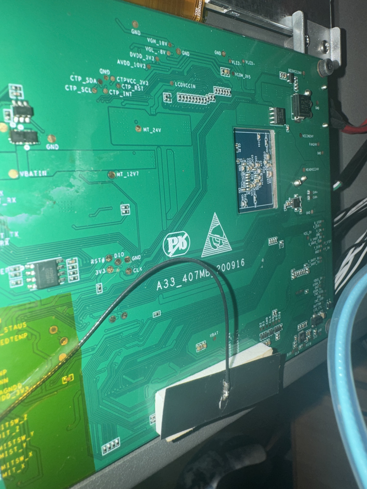
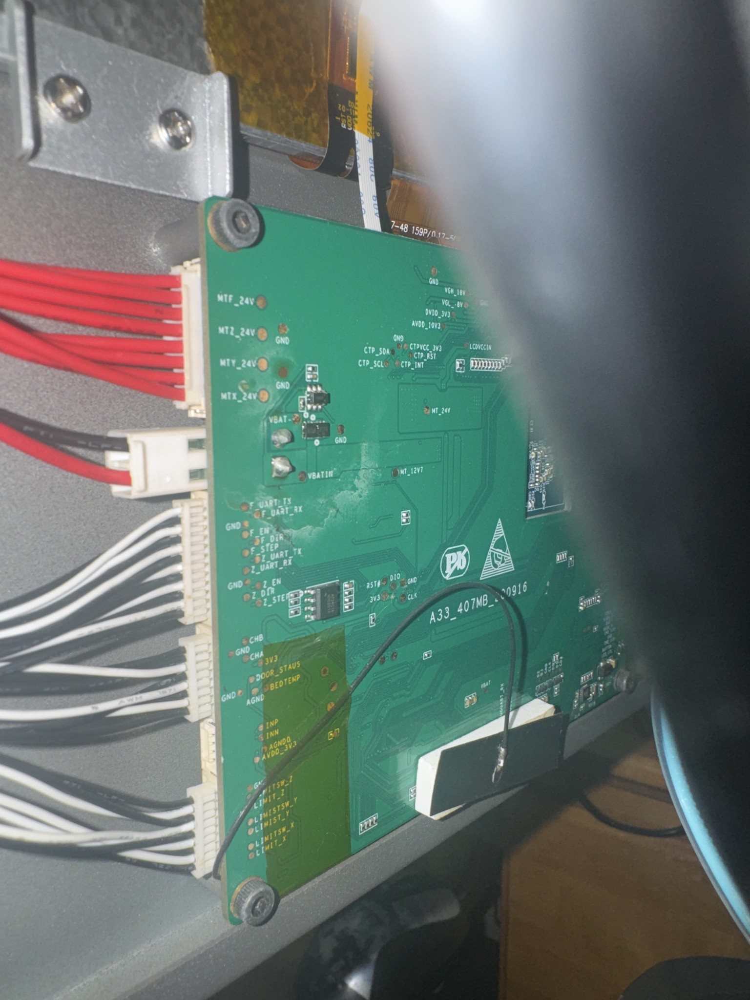
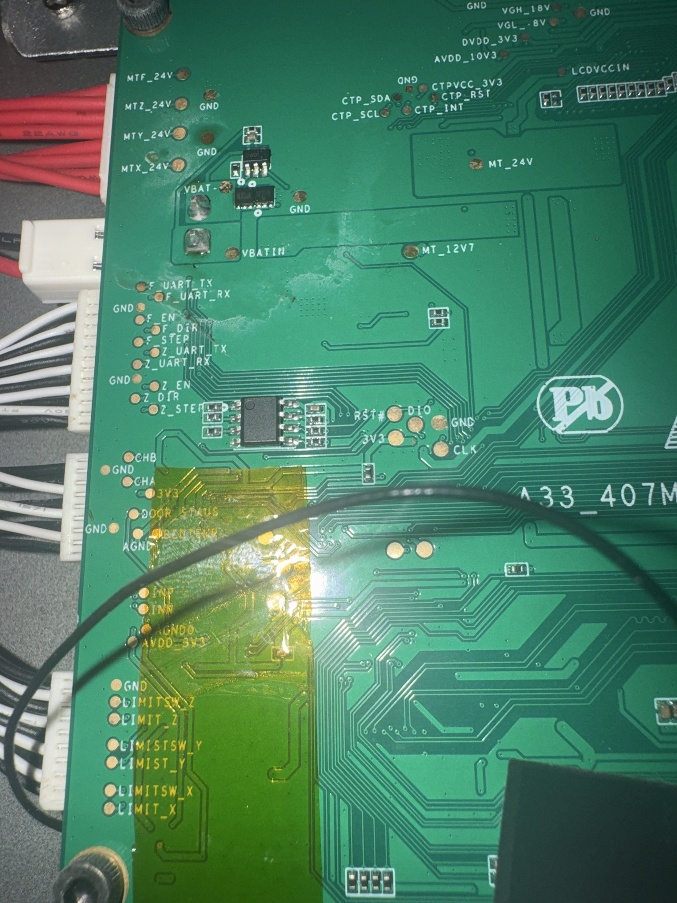
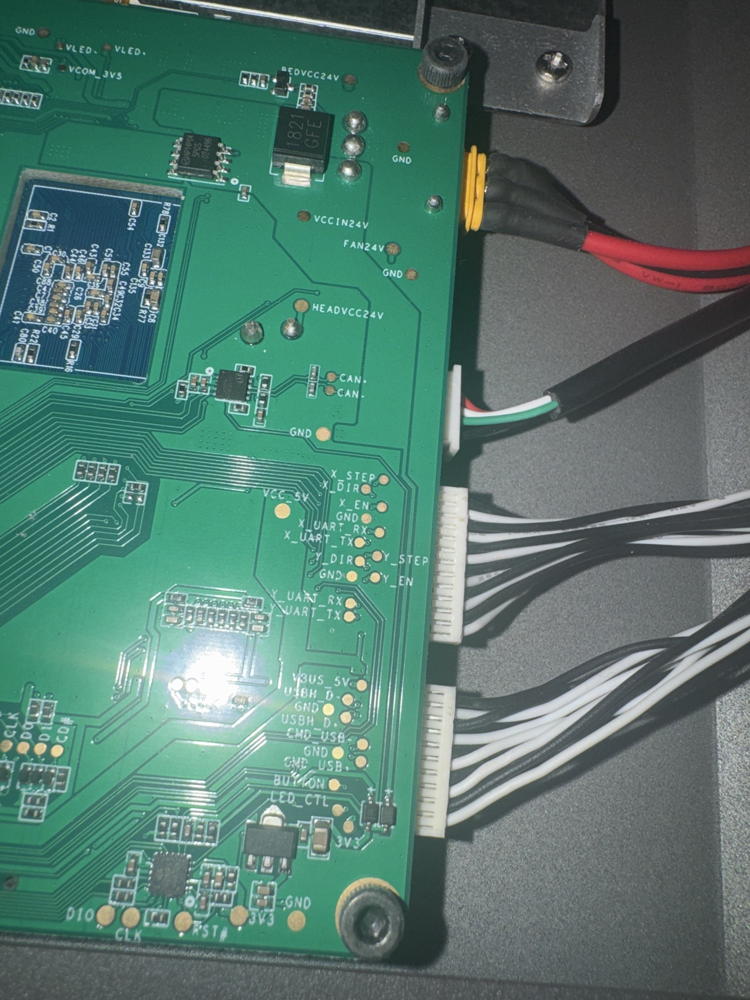

# IVI main board: `A33_407MB_200916`

Photos taken by an owner on 2026-10-31 (EXIF/GPS stripped). Labels: **[P]** read from the photo silkscreen, **[F]** matches firmware decompile (`supx_decompile_report.md`), **[G]** guess.

| Center/right view | Left edge (connectors) |
|---|---|
|  |  |

| Left edge close-up (full silkscreen) | Right edge (connectors) |
|---|---|
|  |  |

## What the board marking tells us
- `A33_407MB_200916` **[P]**: one **combined main board** carrying an **Allwinner A33** (quad Cortex-A7, runs Linux + the Qt UI + the HTTP server) and the **STM32F407** motion MCU (Marlin). `200916` is probably the design date, 2020-09-16 **[G]**.
- The forum's "ARM A7 control board (Related with LCD)" is this A33 side. Earlier notes guessing a Rockchip RK3128 (from `rk312x`/`sinlinx` strings in `firmware.bin`) were wrong; those strings likely come from a reused vendor SDK/toolchain **[G]**.
- The LCD/touch panel, Wi-Fi antenna, and power rails all land on this board. Motor driver boards and the power/switch PCBs are separate.

## Pads and connectors
| Silkscreen | Location | Meaning / status |
|---|---|---|
| `RST#`, `DIO`, `CLK`, `3V3`, `GND` | center, left of logo | **STM32 SWD** debug pads (NRST, SWDIO, SWCLK). ST-Link clips here for flash backup **[P]** |
| `MTX_24V`, `MTY_24V`, `MTZ_24V`, `MTF_24V` | left edge, red bundle | 24 V feed per motor driver board; one per axis. **F = filament feeder (extruder)** **[P]** (F meaning **[G]**, strongly implied) |
| `VBAT-`, `VBATIN` | upper left | battery-backup (power-loss) input **[P]** |
| `F_UART_TX/RX`, `F_EN`, `F_DIR`, `F_STEP` | left edge | extruder (feeder) driver: per-driver UART + STEP/DIR/EN **[P][F]** |
| `Z_UART_TX/RX`, `Z_EN`, `Z_DIR`, `Z_STEP` | left edge | Z tower driver **[P][F]** |
| 8-pin SOIC chip | just left of the STM32 SWD pads | likely the settings EEPROM or SPI flash; part number unreadable **[P]** (role **[G]**; decompile shows a bit-banged I²C EEPROM **[F]**) |
| `CHB`, `CHA` | left edge | unknown; CAN-H/L or encoder channels **[G]** |
| `3V3`, `DOOR_STAUS` (sic) | left edge | door switch **[P][F]** |
| `AGND`, `BEDTEMP` | left edge | bed thermistor input **[P]** |
| `INP`, `INN`, `AGNDO`, `AVDD_3V3` | left edge | differential analog input with its own analog ground/supply **[P]**; possibly a load cell / strain gauge for bed probing **[G]**. (Earlier reading `TMP/TMN` thermistor was a misread.) |
| `LIMITSW_X/Y/Z` **and** `LIMIT_X/Y/Z` | lower left | two pads per axis **[P]**; three tower MAX endstops **[F]**. Why two per axis is unknown: switch + sensor signal/power, or redundant switches **[G]** |
| `MT_24V`, `MT_12V7` | center | motor 24 V rail and a 12.7 V rail **[P]** |
| `VCCIN24V`, `FAN24V`, `GND` | right edge, top (red/black pigtail) | main 24 V input and fan 24 V rail **[P]** |
| `BEDVCC24V` | right edge, top | heated bed 24 V **[P]** |
| `CAN+`, `CAN-`, `HEADVCC24V` | right edge, 3-wire cable | **toolhead CAN bus + head 24 V, confirmed** **[P][F]** (CAN2, head ID 0x12) |
| `X_STEP/DIR/EN`, `X_UART_RX/TX` | right edge, upper connector | X tower driver **[P][F]** |
| `Y_STEP/DIR/EN`, `Y_UART_RX/TX` | right edge, upper connector | Y tower driver **[P][F]**. All four drivers (X, Y, Z, F) now confirmed with STEP/DIR/EN + UART |
| `VCC_5V` | right side | 5 V rail **[P]** |
| `VBUS_5V`, `USBH_D+`, `USBH_D-` | right edge, lower connector | USB **host** port (front USB stick?) **[P]** (use **[G]**) |
| `CMD_USB`, `GND_USB` | right edge, lower connector | likely the USB-C device port to the STM32 **[G]** |
| `BUTTON`, `LED_CTL` | right edge, lower connector | front power/user button and LED **[P]** (use **[G]**) |
| second `DIO`, `CLK`, `RST#`, `3V3`, `GND` set | bottom right, next to small QFN chip | second SWD port, so the QFN is probably a second MCU, perhaps a USB-serial bridge **[G]** |
| `CTP_SDA/SCL/RST/INT`, `CTPVCC_3V3` | top | capacitive touch controller (I²C) **[P]** |
| `LCDVCCIN`, `VGH_18V`, `VGL_-8V`, `DVDD_3V3`, `AVDD_10V3`, `VCOM_3V5`, `VLED+/-` | top | LCD panel bias and backlight rails **[P]** |
| shielded module + antenna lead | center/bottom | Wi-Fi **[P]** |

The `_TX`/`_RX` fragments seen at the far left of the center photo are the `F_UART`/`Z_UART` pads above, not a separate console. **No A33 Linux UART console header has been identified yet**; look for unpopulated 3–4 pin pads near the A33 (`UART0` on A33 is usually PF2/PF4 via the SD pins or PB0/PB1).

## Confirms vs. decompile
- One UART per closed-loop driver, plus STEP/DIR/EN from the STM32 **confirmed**.
- Three MAX endstops and a door switch **confirmed**.
- Toolhead on CAN with its own 24 V supply **confirmed**; heater/fan/laser power are on the head side, so no hotend MOSFET on this board is expected.
- All four drivers (X, Y, Z, F) wired with STEP/DIR/EN + UART **confirmed**.
- SWD location found, so the readout-protection check and a full flash backup are now practical.

## Open questions
- Which STM32 pins / USART remap each `*_UART` pad uses (resolves §8 of the decompile report)
- `CHA/CHB` role; `INP/INN` sensor type (load cell?); why each axis has `LIMITSW_` + `LIMIT_`
- 8-pin SOIC and bottom-right QFN part numbers; what the second SWD port programs
- A33 serial console location; boot media (eMMC/NAND/SD)
- STM32 RDP level (read via ST-Link: `st-info --probe`, or STM32CubeProgrammer)

## Multimeter tracing guide (power OFF)
1. Continuity mode. Put one probe on a labeled pad (e.g. `Z_UART_TX`), drag the other along the STM32F407VET6 (LQFP100) pins; pin 1 is at the dot.
2. Map pin number → port with the STM32F407 datasheet LQFP100 pinout (e.g. pin 47 = PB10 = USART3_TX).
3. Record in a table here: pad → pin → port → peripheral. Do the same for `F_*`, X/Y pads, `CHA/CHB`, `INP/INN`, `BEDTEMP`, `LIMITSW_*`, `LIMIT_*`, `DOOR_STAUS`.
4. For the A33 console: with power ON, measure unknown 3-pin pad groups to GND; a pad idling at 3.3 V that flickers at boot is TX. Use a 3.3 V USB-serial adapter at 115200.
5. Never apply 5 V adapters; SWD and UART are 3.3 V.
